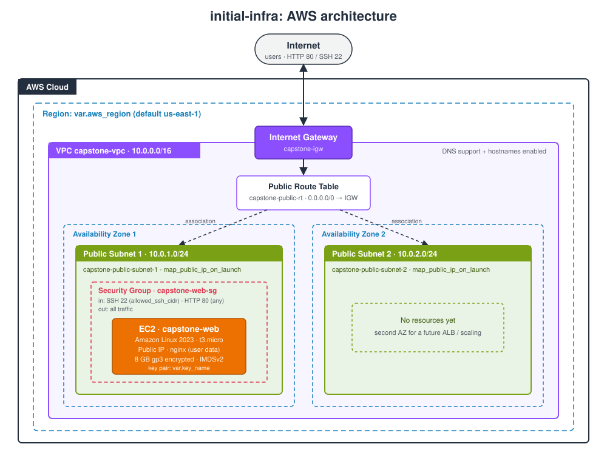

# Initial Infrastructure (Terraform on AWS)

This Terraform configuration sets up basic AWS networking and one public EC2 instance running nginx.

## Architecture



## Resources created

| Resource | Name (tag) | Details |
|---|---|---|
| VPC | `<project>-vpc` | CIDR `10.0.0.0/16`, DNS support and DNS hostnames enabled |
| Internet Gateway | `<project>-igw` | Attached to the VPC |
| Public Subnet 1 | `<project>-public-subnet-1` | `10.0.1.0/24`, first available AZ, auto-assigns public IPs |
| Public Subnet 2 | `<project>-public-subnet-2` | `10.0.2.0/24`, second available AZ, auto-assigns public IPs |
| Route Table | `<project>-public-rt` | Default route `0.0.0.0/0` → Internet Gateway, associated with both subnets |
| Security Group | `<project>-web-sg` | Inbound: SSH (22) from `allowed_ssh_cidr`, HTTP (80) from anywhere. Outbound: all traffic |
| EC2 Instance | `<project>-web` | Latest Amazon Linux 2023, `t3.micro`, in Public Subnet 1, public IP, nginx installed at boot |

`<project>` is the value of `project_name` (default `capstone`).

The default provider tags `Project=<project_name>` and `ManagedBy=terraform` are added to every resource.

### EC2 instance details
- **AMI:** the latest Amazon Linux 2023 (x86_64), looked up from the AWS public SSM parameter.
- **User data:** installs nginx, then enables and starts it.
- **Root volume:** 8 GB gp3, encrypted.
- **Instance metadata:** IMDSv2 is required (`http_tokens = "required"`).

## File layout

| File | Purpose |
|---|---|
| `versions.tf` | Terraform and AWS provider version constraints, provider configuration, default tags |
| `variables.tf` | Input variables |
| `main.tf` | All resources (VPC, subnets, IGW, route table, security group, EC2) |
| `outputs.tf` | Output values |
| `terraform.tfvars.example` | Sample variable values; copy it to `terraform.tfvars` |
| `.gitignore` | Keeps state files, `.terraform/` and `*.tfvars` out of git |

## Input variables

| Variable | Default | Description |
|---|---|---|
| `aws_region` | `us-east-1` | AWS region to deploy into |
| `project_name` | `capstone` | Name prefix for all resources |
| `vpc_cidr` | `10.0.0.0/16` | VPC CIDR block |
| `public_subnet_cidrs` | `["10.0.1.0/24", "10.0.2.0/24"]` | CIDRs for the two public subnets |
| `instance_type` | `t3.micro` | EC2 instance type |
| `key_name` | `null` | Name of an existing EC2 key pair for SSH. Leave it unset to launch without a key |
| `allowed_ssh_cidr` | `0.0.0.0/0` | CIDR allowed to SSH in. **Restrict this to your own IP** |

## Outputs

| Output | Description |
|---|---|
| `vpc_id` | ID of the VPC |
| `public_subnet_ids` | IDs of the two public subnets |
| `instance_id` | ID of the EC2 instance |
| `instance_public_ip` | Public IP of the EC2 instance |
| `instance_public_dns` | Public DNS name of the EC2 instance |

## Prerequisites
- Terraform >= 1.5
- AWS credentials configured, for example with `aws configure` or environment variables
- (Optional) An existing EC2 key pair in the target region, needed for SSH access

## Usage

```bash
cd initial-infra

# 1. Set your variables
cp terraform.tfvars.example terraform.tfvars
#    edit key_name and allowed_ssh_cidr (e.g. "203.0.113.10/32")

# 2. Deploy
terraform init
terraform plan
terraform apply

# 3. Get the instance address
terraform output instance_public_ip
```

### Verify
- **Web:** open `http://<instance_public_ip>` in a browser. You should see the nginx welcome page. Boot can take a minute or two.
- **SSH:** `ssh -i /path/to/key.pem ec2-user@<instance_public_ip>`

### Tear down

```bash
terraform destroy
```

## Notes
- **State:** state is stored locally in `terraform.tfstate`. For team use, configure a remote backend such as S3 with DynamoDB locking.
- **SSH access:** `allowed_ssh_cidr` defaults to `0.0.0.0/0`. Change it to your own `/32` before applying.
- **Second subnet:** Public Subnet 2 has no instances yet. It provides a second AZ for later additions such as a load balancer or more instances.
