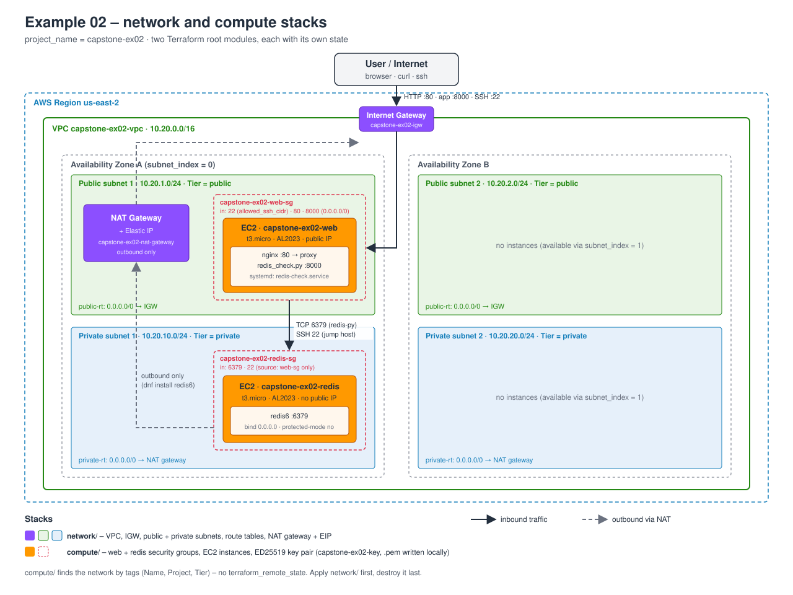

# Example 02: network and compute as separate stacks

This is the same setup as `../01-initial-infra`, split into two Terraform root modules. Each module has its **own state file**.
`01-initial-infra/` is not changed.



```
02-example/
├── network/   VPC, IGW, public/private subnets, NAT gateway, route tables -> network/terraform.tfstate
└── compute/   SSH key pair, web + redis security groups, EC2 instances    -> compute/terraform.tfstate
```

## How compute finds the network

`compute/` does **not** read the network state (no `terraform_remote_state`). It finds each network component with data sources that filter on tags:

| Component | Lookup (`compute/data.tf`) |
|---|---|
| VPC | `Name = <project>-vpc`, `Project = <project>` |
| Public subnets | in that VPC, `Tier = public`, `Project = <project>` |
| Private subnets | in that VPC, `Tier = private`, `Project = <project>` |

The security groups (`<project>-web-sg` and `<project>-redis-sg`) are created in `compute/`. Redis accepts port 6379 and SSH only from the web security group.

`project_name` defaults to `capstone-ex02`, so these lookups never match the VPC that `01-initial-infra` created (`Project = capstone`).
Both stacks must use the same `project_name` and `aws_region`.

## Key pair

`compute/` generates an ED25519 key with the `tls` provider and registers it as `<project>-key`.
The private key is written to `compute/<project>-key.pem` (mode 0400, git-ignored).
The private key is also stored in `compute/terraform.tfstate`, so keep that state file private.

## Usage

Apply the network first, then compute:

```bash
cd 02-example/network
cp terraform.tfvars.example terraform.tfvars
terraform init && terraform apply

cd ../compute
cp terraform.tfvars.example terraform.tfvars   # set allowed_ssh_cidr to your IP/32
terraform init && terraform apply
terraform output ssh_command
```

Open `http://<instance_public_ip>` to see the Python app talking to Redis (each refresh bumps a visits counter).

## Tear down

Destroy in reverse order. The network cannot be deleted while the instance still uses it.

```bash
cd 02-example/compute && terraform destroy
cd ../network       && terraform destroy
```

## Notes
- Default CIDR is `10.20.0.0/16`, so it does not overlap `01-initial-infra` (`10.0.0.0/16`).
- To recreate the EC2 instance, run `apply` or `destroy` in `compute/` only. The network and its state are not affected.
- If the network stack is not applied yet, `compute` plans fail with "no matching VPC found".
