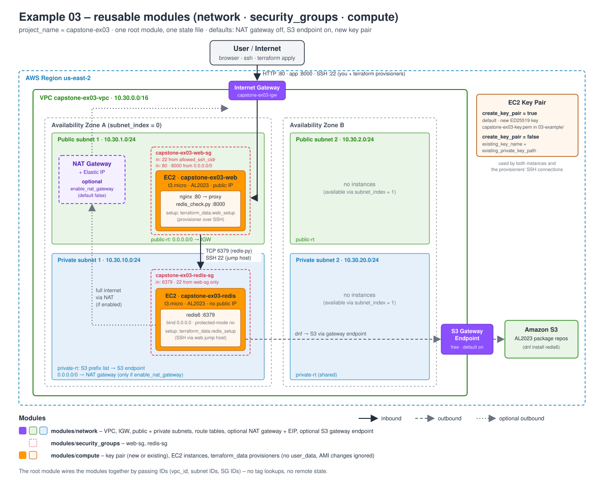

# Example 03: reusable modules

The same web + Redis setup as `../02-example`, restructured as one root module that calls three child modules. Everything lives in **one state file** (`terraform.tfstate` in this folder).



```
03-example/
├── main.tf / variables.tf / outputs.tf / versions.tf   root: provider + module calls
└── modules/
    ├── network/           VPC, IGW, public/private subnets, route tables,
    │                      optional NAT gateway, optional S3 gateway endpoint
    ├── security_groups/   web SG (SSH, HTTP, app port) and redis SG (6379 + SSH from web SG only)
    └── compute/           key pair (new or existing), web + redis EC2 instances,
                           provisioner-based setup (templates/, scripts/)
```

Modules pass IDs to each other directly (`module.network.vpc_id` → `security_groups` → `compute`). Unlike 02, nothing is looked up by tags.

## Options

### NAT gateway: `enable_nat_gateway` (default `false`)

| Setting | Private subnet outbound | Cost |
|---|---|---|
| `false` | S3 gateway endpoint only. Enough for `dnf` on Amazon Linux 2023, whose repos are served from S3 | free |
| `true`  | Full internet through a NAT gateway in the first public subnet | NAT hourly + data charges |

`enable_s3_gateway_endpoint` (default `true`) controls the endpoint. A validation stops you from turning off both, because Redis could not install packages.

### Key pair: `create_key_pair` (default `true`)

- **`true`**: Terraform generates an ED25519 key and registers it as `<project>-key`. It writes the private key to `./<project>-key.pem` (mode 0400, git-ignored). The private key is also stored in state, so keep `terraform.tfstate` private.
- **`false`**: uses a key pair that already exists in EC2. Set:
  ```hcl
  create_key_pair           = false
  existing_key_name         = "my-key"
  existing_private_key_path = "~/.ssh/my-key.pem"
  ```
  The private key path is required because the provisioners SSH in with it. The key name is checked at plan time.

## Instance setup (provisioners, not user_data)

The instances have no `user_data`. `terraform_data.redis_setup` and `terraform_data.web_setup` upload and run the scripts in `modules/compute/templates/` over SSH. Redis is reached through the web instance as a jump host.

- **Changing a script** re-runs it on the existing instance. The instance is **not** replaced.
- **To re-run a setup** without changing its script:
  ```bash
  terraform apply -replace=module.compute.terraform_data.web_setup
  ```
- The AMI is ignored after creation (`ignore_changes = [ami]`), so a new AL2023 release doesn't rebuild the instances.
- Terraform SSHes from the machine running `apply`, so `allowed_ssh_cidr` must include your IP.

## Usage

```bash
cd 03-example
cp terraform.tfvars.example terraform.tfvars   # set allowed_ssh_cidr, choose NAT / key options
terraform init
terraform apply
terraform output app_url
terraform output ssh_command
```

Open the `app_url`. Each refresh bumps a Redis-backed visit counter.

## Tear down

```bash
terraform destroy
```

## Notes
- Default CIDR is `10.30.0.0/16` and `project_name` is `capstone-ex03`, so this doesn't collide with 01 (`10.0.0.0/16`) or 02 (`10.20.0.0/16`).
- Requires Terraform >= 1.9 (for validations that reference other variables).
